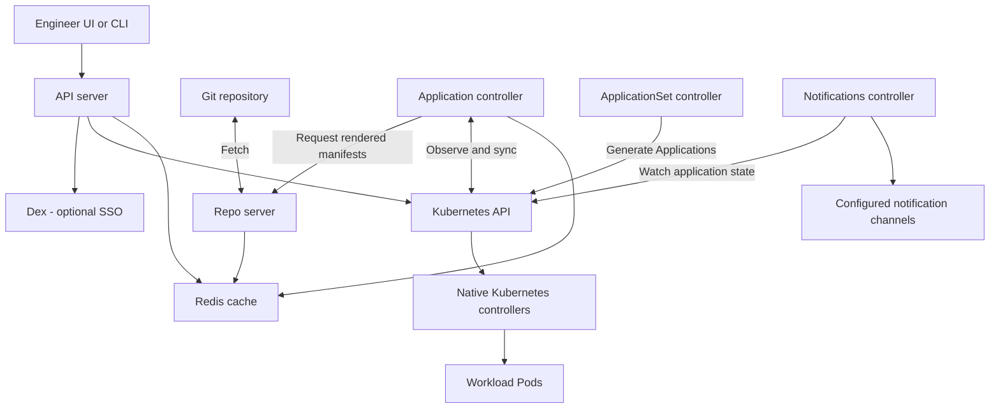

# Argo CD architecture deep dive

[Back to installation](README.md)

## Why GitOps?

A push pipeline applies manifests at deployment time. Argo CD instead retrieves declared desired state and repeatedly compares it with live Kubernetes resources. Manual sync, automated sync, self-heal and prune are distinct policies. GitOps does not prevent all manual changes.

## Components and communication



Logical diagram, not an exhaustive network trace.

| Component | Responsibility | Failure impact |
|---|---|---|
| argocd-server | UI/API, authentication and authorization, application management | UI/API unavailable; independent reconciliation may continue |
| repo-server | Fetch Git and render YAML, Helm or Kustomize | Fresh manifest generation may fail |
| application-controller | Compare desired/live, assess health, execute sync | Drift detection and sync impaired |
| applicationset-controller | Generate and manage Applications from templates and generators | Generated Application updates stop; existing Applications can reconcile |
| Redis | Disposable cache, not authoritative Application storage | Cache-dependent operations may degrade or fail |
| Dex | Optional external identity federation | Dex-dependent login fails |
| notifications-controller | Evaluate triggers and deliver configured alerts | Notifications delayed or unavailable |

Existing workload Pods are not automatically terminated by failure of these management components.

## Observed installation evidence

Learner confirmed dashboard login and reported the following Services. All are ClusterIP, with no external IP. Addresses are cluster-specific and omitted.

| Service | Ports | Purpose |
|---|---|---|
| argocd-application-controller | None | Headless Service |
| argocd-applicationset-controller | 7000, 8080 | Webhook, metrics |
| argocd-dex-server | 5556, 5557, 5558 | Identity endpoints and telemetry |
| argocd-metrics | 8082 | Controller metrics |
| argocd-notifications-controller-metrics | 9001 | Metrics |
| argocd-redis | 6379 | Cache |
| argocd-repo-server | 8081, 8084 | Manifest RPC, metrics |
| argocd-server | 80, 443 | UI/API |
| argocd-server-metrics | 8083 | Metrics |

A headless Service has no virtual ClusterIP; it is not a broken Service. Metrics endpoints are not evidence that Prometheus is already scraping them.

Three CRDs were observed, all defining namespaced resources with v1alpha1 storage version: applications.argoproj.io, applicationsets.argoproj.io, appprojects.argoproj.io. CRD objects themselves are cluster-scoped.

- Application: source, revision, path, destination, project and sync policy.
- ApplicationSet: generates Applications from templates and generators.
- AppProject: restricts permitted sources, destinations and resource kinds; can define project roles. It is not a replacement for Kubernetes RBAC.

## Follow a Git commit

1. Developer pushes a manifest change to Git.
2. Periodic refresh or a configured webhook triggers application refresh.
3. Application controller requests desired manifests from repo-server.
4. Repo-server fetches or uses cached repository data and renders manifests.
5. Application controller compares desired resources with observed live resources.
6. If different, the application may be OutOfSync. Manual or automated sync applies changes when permitted.
7. Kubernetes API authenticates and authorizes writes, runs admission and persists accepted resources.
8. Deployment controller reconciles ReplicaSets; ReplicaSet controller reconciles Pods; scheduler assigns nodes; kubelet and runtime start containers.
9. Argo CD observes resource status and updates sync and health information. Synced does not necessarily mean Healthy, and Healthy does not prove business correctness.

## Inspect without changing anything

```powershell
kubectl get applications,applicationsets,appprojects -n argocd
kubectl get svc argocd-repo-server -n argocd -o yaml
kubectl get endpointslice -n argocd
kubectl logs -n argocd statefulset/argocd-application-controller --tail=30
```

These commands are proposed next exercises, not yet verified observations. Review logs before publishing; redact secrets and sensitive details.

## Checkpoint

If GitHub is unavailable but Kubernetes is healthy, predict what happens to existing Pods, fresh Git revisions and cached manifest generation. Explain the distinction between workload availability and deployment availability. Record your answer before testing.

## Further reading

- [Official architecture](https://argo-cd.readthedocs.io/en/stable/operator-manual/architecture/)
- [Automated sync policy](https://argo-cd.readthedocs.io/en/stable/user-guide/auto_sync/)
