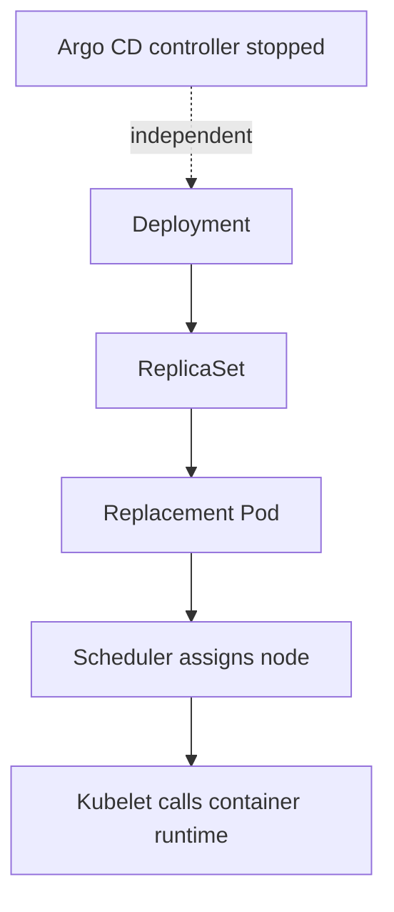

# Controller independence experiment

## Problem
Can native Kubernetes recover a deleted application Pod while the Argo CD application controller is unavailable?

## Reproduce (local kind lab only)
```powershell
kubectl create namespace warfare-argocd-001 --dry-run=client -o yaml | kubectl apply -f -
kubectl apply -f manifests/deployment.yaml
kubectl rollout status deployment/payflow -n warfare-argocd-001
kubectl scale statefulset argocd-application-controller --replicas=0 -n argocd
kubectl get statefulset -n argocd
kubectl get pods -n warfare-argocd-001 -o wide
# Replace the example Pod name with a current Pod name.
kubectl delete pod payflow-8b7684fbf-g679s -n warfare-argocd-001
kubectl get pods -n warfare-argocd-001 -o wide
kubectl get events -n warfare-argocd-001 --sort-by=.metadata.creationTimestamp
# Always restore the controller after the experiment.
kubectl scale statefulset argocd-application-controller --replicas=1 -n argocd
kubectl rollout status statefulset/argocd-application-controller -n argocd
```

## Observed evidence
- Argo CD controller StatefulSet: 0/0 during failure injection, 1/1 after restoration.
- PayFlow ReplicaSet: payflow-8b7684fbf, initially three ready replicas.
- Deleted Pod suffix g679s, IP 10.244.2.58; replacement w6md9, IP 10.244.2.174, both on prod-sim-worker.
- Other Pods n4phg and qwz7n remained present; all three were Running and Ready after recovery.
- No Argo CD Application resources existed. This workload was manually applied, not GitOps-managed.
- Deployment manifest commit: 928c33a.

## Interpretation

The ReplicaSet controller creates replacement Pods; the scheduler assigns a node; kubelet uses the runtime via CRI. Event output was not captured in the supplied evidence, so these component responsibilities are architectural explanations, not an event trace.

## Production trade-offs
Native reconciliation is independent of GitOps reconciliation. A deleted Deployment has no native parent to recreate it in this setup. Argo CD can restore Git-managed resources when self-healing is enabled and reconciliation succeeds. This experiment demonstrates Pod recovery, not uninterrupted HTTP availability or GitOps-managed resource recovery. Never stop a shared production controller without an approved procedure.

## Next
Keep the namespace and workload for Mission 002, which tests adoption by Argo CD. Hands-on experiment complete; GitOps adoption remains untested.
